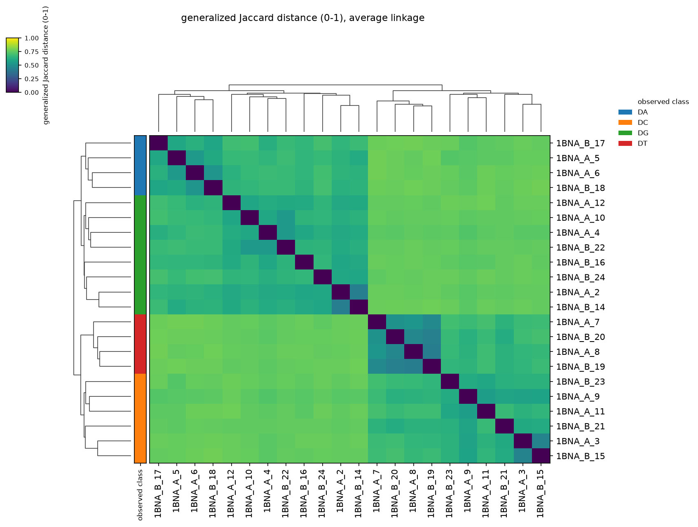
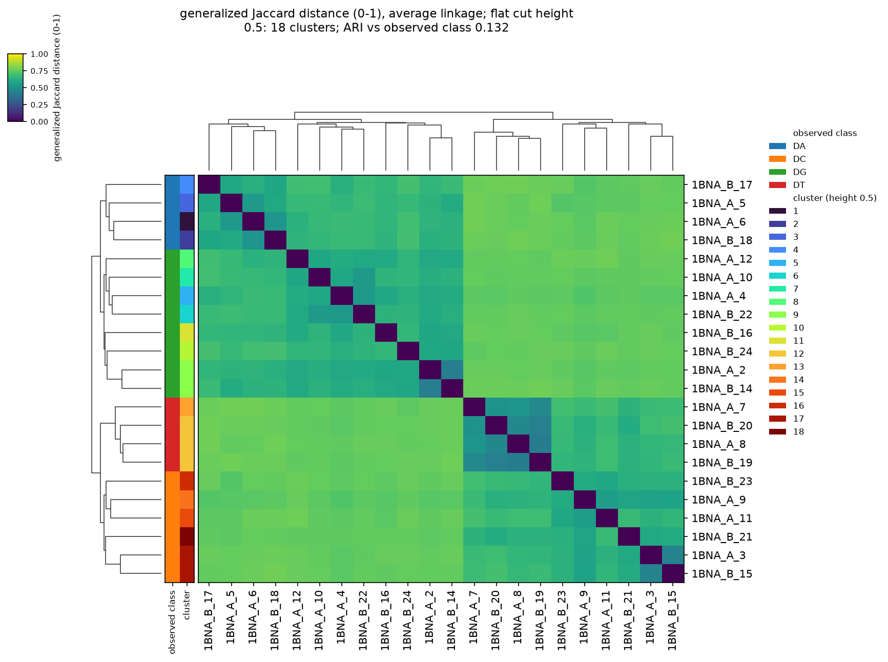
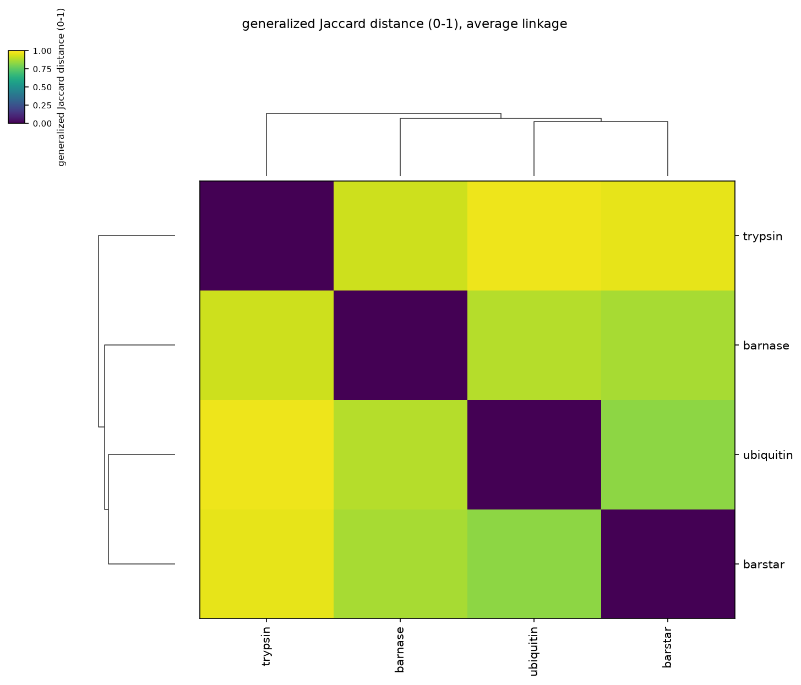

# 08 — Similarity, clustering and the clustered heat map

This page takes saved BioTSR results all the way to a clustered heat map: it
builds a feature matrix, computes generalized and binary Jaccard similarities
and distances, exports them with their sample ids, builds the hierarchical
tree, draws the tree over the ordered heat map, and records how every number
was made. Every block on this page is executed by the test suite on the public
structure 1BNA (a B-DNA dodecamer).

The default result needs **no number of clusters**: it is the tree and the
heat map ordered by it. Cutting the tree into flat clusters is a separate,
optional step (section 8), taken only with a rule you state.

**Python only.** The command line computes the results (`biotsr batch`) and
common keys (`biotsr analyze common-keys`); similarity, the tree and the
figure are in the Python API, `biotsr.analysis`. Computing them needs nothing
beyond BioTSR itself. **Drawing** the figure needs matplotlib, which BioTSR
installs only on request:

<!-- not-executed -->
```bash
pip install "biotsr[plot]"
```

Without it, everything on this page except the drawing steps runs, and asking
for a figure raises `MissingRenderDependency` with that command.

## 1. Compute and save the results

One sample per nucleotide of both strands, computed by the `nucleotide` method.
The sample ids name a position, not a base: the classes come from a separate
table in step 2, never from a name.

<!-- file: nucleotides.csv -->
```csv
sample_id,pdb_id,method,chain,entity_name,entity_id
1BNA_A_2,1BNA,nucleotide,A,DG,2
1BNA_A_3,1BNA,nucleotide,A,DC,3
1BNA_A_4,1BNA,nucleotide,A,DG,4
1BNA_A_5,1BNA,nucleotide,A,DA,5
1BNA_A_6,1BNA,nucleotide,A,DA,6
1BNA_A_7,1BNA,nucleotide,A,DT,7
1BNA_A_8,1BNA,nucleotide,A,DT,8
1BNA_A_9,1BNA,nucleotide,A,DC,9
1BNA_A_10,1BNA,nucleotide,A,DG,10
1BNA_A_11,1BNA,nucleotide,A,DC,11
1BNA_A_12,1BNA,nucleotide,A,DG,12
1BNA_B_14,1BNA,nucleotide,B,DG,14
1BNA_B_15,1BNA,nucleotide,B,DC,15
1BNA_B_16,1BNA,nucleotide,B,DG,16
1BNA_B_17,1BNA,nucleotide,B,DA,17
1BNA_B_18,1BNA,nucleotide,B,DA,18
1BNA_B_19,1BNA,nucleotide,B,DT,19
1BNA_B_20,1BNA,nucleotide,B,DT,20
1BNA_B_21,1BNA,nucleotide,B,DC,21
1BNA_B_22,1BNA,nucleotide,B,DG,22
1BNA_B_23,1BNA,nucleotide,B,DC,23
1BNA_B_24,1BNA,nucleotide,B,DG,24
```

Each row names one residue by chain, name and identifier, so each sample is
that one copy. The two 5′-terminal residues, DC 1 and DC 13, are left out: they
carry no phosphate, so the method's completeness rule excludes them, and a
batch that listed them would report them as failed rows saying exactly that.

```bash
biotsr batch --manifest nucleotides.csv --pdb-dir pdb/ --output nt/ --no-triplets
```

```text
requests 22 ok, 0 skipped, 0 failed
```

`nt/batch_summary.csv` lists every request with its status and its output
(folder and prefix). Every calculation is in the one `nt/` folder, under its
`sample_id` as prefix: `nt/1BNA_A_2.keys`, `nt/1BNA_A_2.meta.json` and the
completion record `nt/1BNA_A_2.run.json`, and so on.

## 2. Load the saved results and match them to labels

The class of each sample comes from your own table, matched by sample id:

<!-- file: classes.csv -->
```csv
sample_id,class
1BNA_A_2,DG
1BNA_A_3,DC
1BNA_A_4,DG
1BNA_A_5,DA
1BNA_A_6,DA
1BNA_A_7,DT
1BNA_A_8,DT
1BNA_A_9,DC
1BNA_A_10,DG
1BNA_A_11,DC
1BNA_A_12,DG
1BNA_B_14,DG
1BNA_B_15,DC
1BNA_B_16,DG
1BNA_B_17,DA
1BNA_B_18,DA
1BNA_B_19,DT
1BNA_B_20,DT
1BNA_B_21,DC
1BNA_B_22,DG
1BNA_B_23,DC
1BNA_B_24,DG
```

```python
import csv, json, os
import biotsr
from biotsr.analysis import AnalysisSample

with open("nt/batch_summary.csv", newline="") as fh:
    rows = list(csv.DictReader(fh))
assert {r["status"] for r in rows} == {"ok"}   # check it: failed rows have no result

with open("classes.csv", newline="") as fh:
    classes = {r["sample_id"]: r["class"] for r in csv.DictReader(fh)}
unmatched = sorted(set(r["sample_id"] for r in rows) ^ set(classes))
assert unmatched == [], unmatched              # every sample labelled, every label used

def load(row):
    """The saved result of a batch row, as an analysis sample."""
    result = biotsr.load_result(row["output"] + ".keys")   # nt/<prefix>.keys
    return AnalysisSample.from_result(result, sample_id=row["sample_id"],
                                      label=classes[row["sample_id"]])

samples = [load(r) for r in rows]
assert len(samples) == 22
```

`biotsr.load_result` reads a keys file and its sidecar and checks that they
agree; the sample keeps both fingerprints and the selection it was computed
with.

## 3. The feature matrix

```python
from biotsr.analysis import feature_matrix

fm = feature_matrix(samples)
print(fm.shape)                       # (samples, distinct keys over all samples)
assert fm.n_samples == 22
assert fm.comparison["processing_uniform"] and fm.warnings == ()

os.makedirs("analysis", exist_ok=True)
with open("analysis/features.csv", "w", newline="") as fh:
    fh.write(fm.to_header_csv())      # sample_id, then one column per key
```

The matrix refuses samples whose keys mean different things (a different key
space), always. It refuses samples processed under different settings (a
different size filter, contact cutoff or completeness rule) unless you pass
`allow_mixed_processing=True`, and then records the difference. What was
selected — structures, chains, residues, residue types, one copy or every copy
of a molecule — never blocks a comparison: that is what a dataset is made of
([analysis methods](../methods/ANALYSIS.md), §1.1).

## 4. Generalized and binary Jaccard

* **Generalized Jaccard** weighs every key by how often it occurs:
  `J = Σ min(a_k, b_k) / Σ max(a_k, b_k)`.
* **Binary Jaccard** looks only at which keys are present:
  `J = |A ∩ B| / |A ∪ B|`.

Both are **similarities** in [0, 1] (1 = identical). The **distance** is
`D = 1 − J`, and BioTSR never converts one into the other unless you ask.

```python
from biotsr.analysis import similarity_matrix

measures = {}
for measure in ("generalized_jaccard", "binary_jaccard"):
    similarity = similarity_matrix(fm, measure)
    distance = similarity.to_distance()
    measures[measure] = (similarity, distance)
    for m in (similarity, distance):
        with open("analysis/%s.csv" % m.corner_label, "w", newline="") as fh:
            fh.write(m.to_csv())

g_sim, g_dist = measures["generalized_jaccard"]
b_sim, b_dist = measures["binary_jaccard"]
n = g_sim.n_samples
for i in range(n):
    assert g_sim.value(i, i) == 1.0 and g_dist.value(i, i) == 0.0
    for j in range(n):
        assert g_sim.value(i, j) == g_sim.value(j, i)
        assert g_dist.value(i, j) == 1.0 - g_sim.value(i, j)
        assert 0.0 <= b_sim.value(i, j) <= 1.0
assert g_dist.units == "fraction"            # 0 to 1, not percent
with open("analysis/generalized_jaccard_distance_pairs.csv", "w", newline="") as fh:
    fh.write(g_dist.to_long_csv())
```

Each square CSV names what its cells are in its first header cell
(`generalized_jaccard_distance`, `binary_jaccard_similarity`, ...), then lists
the sample ids across the top and down the side. The `..._pairs.csv` form has
one row per pair with the measure, kind and scale on every row. If you want
percent, ask for it — `g_dist.scaled(100)` — and its label, CSV heading
(`..._x100`) and conversions say so.

## 5. The tree

Average linkage (UPGMA) on the generalized Jaccard distance. The tree — every
merge with its height, and the leaf order of the dendrogram — is the complete
result; it needs no number of clusters, and it reports none, because an uncut
tree describes groupings at every height rather than one final number of
groups.

```python
from biotsr.analysis import hierarchy

tree = hierarchy(g_dist)
with open("analysis/linkage.csv", "w", newline="") as fh:
    fh.write(tree.to_linkage_csv())       # step, left, right, height, size
with open("analysis/leaf_order.csv", "w", newline="") as fh:
    fh.write(tree.to_order_csv())         # sample_id, leaf_position (0 = top row)

heights = tree.linkage.heights
assert len(heights) == 21 and tree.linkage.is_monotonic
print(round(min(heights), 3), round(max(heights), 3))   # 0.419 0.761
assert tree.provenance()["flat_partition"] is None
```

`linkage.csv` lists the 21 merges in order: `left` and `right` are a sample id
or `cluster<k>`, the group formed at step *k*, and `height` is the average
generalized Jaccard distance at which they were joined. `leaf_order.csv` is the
order of the dendrogram's leaves, which is also the order of the heat map's
rows.

## 6. Draw the tree and the ordered heat map

`clustermap_spec` describes the figure as data — the matrix, the tree, the
leaf order and the observed-class stripe — without drawing it. With the class
labels and **no cutting rule**, there is no partition and so no adjusted Rand
index:

```python
from biotsr.analysis import clustermap_spec

labels = [s.label for s in samples]          # the observed classes, from classes.csv
spec = clustermap_spec(g_dist, labels)
assert spec.has_classes and not spec.has_clusters
assert spec.assignment is None and spec.adjusted_rand is None
assert spec.ordered_sample_ids() == tree.ordered_sample_ids()

with open("analysis/plot_order.csv", "w", newline="") as fh:
    fh.write(spec.to_row_names_csv())     # the heat map's rows, top to bottom

try:
    spec.to_assignments_csv()             # there are no clusters to write
except ValueError as error:
    assert "no flat partition" in str(error)
else:
    raise AssertionError("an uncut tree has no cluster assignments")
```

<!-- requires: plot -->
```python
from biotsr.analysis.render import render_clustermap

render_clustermap(spec, "analysis/clustermap.png", dpi=150)
assert os.path.getsize("analysis/clustermap.png") > 0
```



Rows and columns follow the dendrogram, drawn on both sides. The colour bar is
the generalized Jaccard distance, 0 to 1. The one stripe is the **observed
class** from `classes.csv`, explained in the legend; it is there to be looked
at against the tree, not to define it — the tree was built from the distances
alone. Reading the tree against the stripe: in this structure the first 18 of
the 21 merges, up to a distance of 0.63, each join nucleotides of the same
base, so each base forms its own subtree; those then join as purines (DA, DG)
and pyrimidines (DC, DT) before the root. That is a description of this one
structure, not a claim that it generalises, and it is checked rather than
assumed:

```python
members = {i: {labels[i]} for i in range(n)}      # the classes under each node
for k, (left, right, height, size) in enumerate(tree.linkage.rows):
    members[n + k] = members[int(left)] | members[int(right)]
one_base = [len(members[n + k]) == 1 for k in range(n - 1)]
assert all(one_base[:18]) and not any(one_base[18:])
assert round(heights[17], 2) == 0.63
```

## 7. Record how it was made

```python
provenance = {
    "biotsr_version": biotsr.__version__,
    "inputs": {"batch_summary": "nt/batch_summary.csv", "classes": "classes.csv"},
    "settings": {"measure": "generalized_jaccard", "linkage": "average",
                 "flat_partition": None},
    "feature_matrix": fm.provenance(),
    "distance_matrix": g_dist.provenance(),
    "clustering": spec.provenance(),
}
with open("analysis/provenance.json", "w") as fh:
    json.dump(provenance, fh, indent=2, sort_keys=True, default=str)
assert provenance["clustering"]["leaf_order"] == list(spec.ordered_sample_ids())
assert provenance["clustering"]["adjusted_rand_index"] is None
```

`provenance.json` holds the version, the measure and formula, the scale, the
linkage settings, the leaf order, the class labels and where they came from,
every sample's fingerprints, processing settings and selection, any warning,
and — explicitly — that no flat partition was made.

## 8. Optional: flat clusters from a rule you state

A flat partition is needed only when a study asks a question about one: "which
samples fall in the same group under this rule?" It needs an explicit cutting
rule, and the rule must be chosen **independently of the labels** it will be
compared with. BioTSR offers two, and never chooses one for you:

* `height=h` — cut every merge above `h`, in the matrix's units, so no cluster
  joins samples whose average distance exceeds `h`;
* `n_clusters=t` — `maxclust`: the lowest cut leaving at most `t` clusters.

Choosing `t` from the known classes — four clusters because the sample holds
four bases — makes any agreement with those classes partly a consequence of
that choice: the cut is then built to resemble the answer. It is not evidence
that the data contain four groups.

The rule used here is stated before looking at the tree: **height 0.5** — two
nucleotides may share a cluster only if, on average, they share at least half
of their weighted keys (generalized Jaccard similarity of at least 0.5). Only
for this defined partition is the adjusted Rand index (ARI) against the
observed classes computed:

```python
from biotsr.analysis import cut_hierarchy

CUT_HEIGHT = 0.5                          # stated a priori, not tuned to the labels

partition = cut_hierarchy(tree, height=CUT_HEIGHT)
cut_spec = clustermap_spec(g_dist, labels, height=CUT_HEIGHT)
assert cut_spec.assignment.labels == partition.labels
print(partition.n_clusters, round(cut_spec.adjusted_rand, 3))   # 18 0.132
assert partition.n_clusters == 18

with open("analysis/clusters_height_0.5.csv", "w", newline="") as fh:
    fh.write(cut_spec.to_assignments_csv())   # sample_id, cluster, leaf_position, class_label
with open("analysis/provenance_height_0.5.json", "w") as fh:
    json.dump({"cut_rule": cut_spec.cut_description(),
               "cut_rule_choice": "stated before the analysis: generalized "
                                  "Jaccard similarity of at least 0.5",
               "clustering": cut_spec.provenance()},
              fh, indent=2, sort_keys=True, default=str)
assert cut_spec.provenance()["flat_partition"] == "height 0.5"
```

Only four merges lie below 0.5, so three groups form — three DTs, two DGs and
two DCs — and the other 15 nucleotides stay on their own: 18 clusters, and an
ARI of 0.13 against the bases. Every group that forms holds a single base, but
at this stringency most nucleotides are not grouped at all. A different rule is
a different question and gives a different answer, so report the rule with the
number. `n_clusters=` works the same way, in `cut_hierarchy` and in
`clustermap_spec`; give one rule, not both.

<!-- requires: plot -->
```python
render_clustermap(cut_spec, "analysis/clustermap_height_0.5.png", dpi=150)
```



The figure now has two stripes, labelled differently: the **observed class**
from your table and the **cluster** from the cut, with the rule (`height 0.5`),
the number of clusters and the ARI in the title.

## 9. A small set without labels

Class labels are optional. Four protein chains, with no labels and no cut,
draw as the tree and the ordered heat map alone:

<!-- file: chains.csv -->
```csv
sample_id,pdb_id,method,chain
ubiquitin,1UBQ,protein,A
barnase,1BRS,protein,A
barstar,1BRS,protein,D
trypsin,3PTB,protein,A
```

```bash
biotsr batch --manifest chains.csv --pdb-dir pdb/ --output chains/ --no-triplets
```

```python
with open("chains/batch_summary.csv", newline="") as fh:
    chain_rows = list(csv.DictReader(fh))
chain_samples = [AnalysisSample.from_result(biotsr.load_result(r["output"] + ".keys"),
                                            sample_id=r["sample_id"])
                 for r in chain_rows]

chains_dist = similarity_matrix(feature_matrix(chain_samples)).to_distance()
chains_spec = clustermap_spec(chains_dist)
assert chains_spec.has_classes is False and chains_spec.has_clusters is False
assert chains_spec.adjusted_rand is None
```

<!-- requires: plot -->
```python
render_clustermap(chains_spec, "analysis/chains_clustermap.png", dpi=150)
```



## 10. What to look at, and the limits

| file | what it is |
|---|---|
| `nt/batch_summary.csv` | one row per request: status, output prefix, message — check it before analysing |
| `analysis/features.csv` | the feature matrix: `sample_id`, then each key's frequency |
| `analysis/<measure>_<similarity\|distance>.csv` | square matrices, sample ids on both axes |
| `analysis/generalized_jaccard_distance_pairs.csv` | one row per pair, with measure, kind and scale |
| `analysis/linkage.csv` | the tree: every merge with its height |
| `analysis/leaf_order.csv`, `analysis/plot_order.csv` | the dendrogram's leaf order: the figure's rows, top to bottom |
| `analysis/provenance.json` | everything needed to say how the numbers were made |
| `analysis/clustermap.png` | the figure: tree, ordered heat map, observed class |
| `analysis/clusters_height_0.5.csv`, `analysis/provenance_height_0.5.json` | only for the optional cut: per sample its cluster, dendrogram position and class, and the rule |

* **Empty samples.** A sample with no keys has similarity 1 with another empty
  sample and 0 with any other; the matrix then carries a warning.
* **Size.** Similarity and clustering take time and memory quadratic in the
  number of samples and run in one process; `--jobs` speeds up the structure
  computations of a batch, not this analysis. See the
  [analysis methods](../methods/ANALYSIS.md), §5.8, for measured timings, and
  prefer the exported CSVs to the figure for more than about a hundred samples.
* **SciPy.** The clustering needs no SciPy; how far it agrees with two SciPy
  releases is stated in the [analysis methods](../methods/ANALYSIS.md), §5.7.
